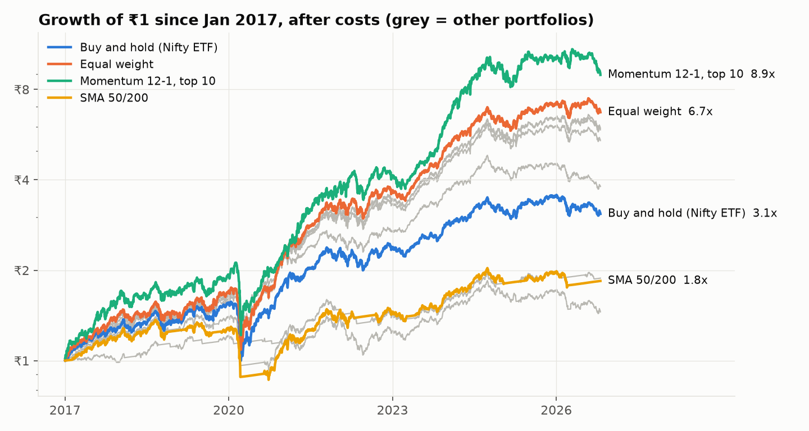
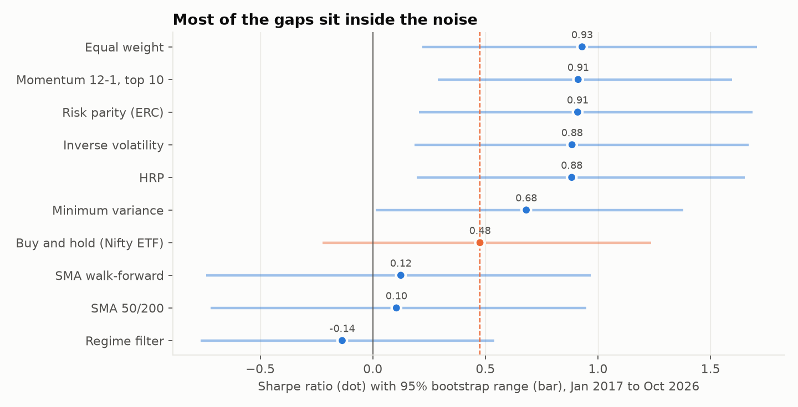
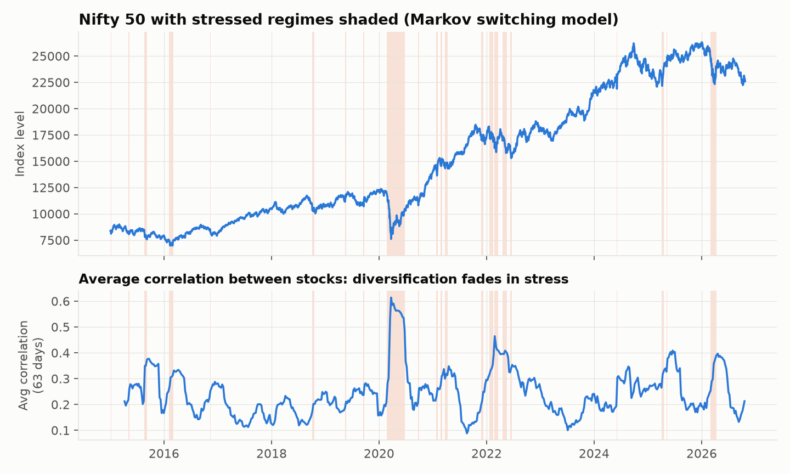

# Nifty 50 Risk, Regimes and Backtests

How risky are India's 50 largest stocks, what changes when markets get stressed, and do simple strategies or smarter portfolio weights beat holding the index after costs? I used ten years of daily prices, DuckDB SQL for the risk metrics and Python for the models. Every strategy result is out of sample.

**[Dashboard on Tableau Public](https://public.tableau.com/app/profile/chayan.gulgulia/viz/Nifty50RiskRegimesandBacktests/Strategiesandregimes)**



## Results

Strategies run from Jan 2017 to Oct 2026, after 10 bps trading costs.

- **Trend timing lost to buy-and-hold.** The 50/200-day moving average rule made 6.6% a year against 12.4% for the Nifty 50 ETF (Sharpe 0.10 vs 0.48). Re-picking the best moving-average pair every year did no better (6.8%).
- **Diversification fades when it is needed most.** Average correlation between stocks is 0.19 in calm markets and 0.49 in stressed ones. Stressed days are 10.7% of the sample, with three times the daily volatility.
- **Momentum's edge was survivorship bias.** Buying last year's 10 best stocks returned 25.6% a year, but an equal-weight basket of the same 50 stocks returned 21.9% with a slightly higher Sharpe. Momentum came out ahead in only 45% of bootstrap resamples.
- **Risk-based weights cut losses, not returns.** HRP lowered the worst drawdown from -37.9% to -32.6% against equal weight, at the same Sharpe. In stressed markets it lost 11.9% a year against 16.8%.
- **Only GARCH VaR passed both backtests at 99%.** Historical and normal VaR breaches came in clusters. GARCH-t had 36 breaches against 26.6 expected (Kupiec p = 0.08, Christoffersen p = 0.51).



Ten years of daily data still leaves wide ranges around each Sharpe. Every portfolio of these 50 stocks beats the index ETF, but that gap comes from survivorship bias (see Limitations), so the fair test is against equal weight on the same stocks.

| Strategy | Return a year | Volatility | Sharpe (95% range) | Worst drawdown |
|---|---|---|---|---|
| Buy and hold, Nifty ETF | 12.4% | 14.7% | 0.48 (-0.22 to 1.24) | -36.3% |
| SMA 50/200 | 6.6% | 11.3% | 0.10 (-0.72 to 0.95) | -36.8% |
| Regime filter | 4.0% | 10.3% | -0.14 (-0.77 to 0.54) | -25.7% |
| Momentum 12-1, top 10 | 25.6% | 21.1% | 0.91 (0.29 to 1.60) | -42.7% |
| Equal weight | 21.9% | 16.6% | 0.93 (0.22 to 1.71) | -37.9% |
| Risk parity | 20.2% | 15.1% | 0.91 (0.21 to 1.69) | -34.7% |
| HRP | 19.2% | 14.5% | 0.88 (0.20 to 1.65) | -32.6% |
| Minimum variance | 14.9% | 13.1% | 0.68 (0.01 to 1.38) | -28.3% |



The regime filter, which steps out of the market when the model sees stress, avoided the worst days (its worst stressed day was -3.7% against -10.2%), but it sold after the fall and missed the rebound. It also traded 22 times a year, which cost 2.2% a year in fees.


The 10 clusters mostly follow NSE sectors, with a few differences: "Financial Services" splits into private banks with Bajaj, insurers, and BSE with the newer names, and PSU energy and power companies group together.

## Data

- **Stocks:** today's 50 Nifty 50 members from NSE's [constituent list](https://nsearchives.nseindia.com/content/indices/ind_nifty50list.csv).
- **Prices:** daily adjusted prices from Yahoo Finance (`yfinance`), 1 Jan 2015 to 23 Oct 2026, 144,371 rows. Not stored in this repo; `run.py` downloads them.
- **Benchmarks:** the Nifty 50 index (`^NSEI`) for beta and regimes, and the Nifty 50 ETF (`NIFTYBEES`, which keeps dividends in its price) for buy-and-hold.
- **Assumptions:** risk-free rate 6% a year, trading cost 10 bps.

I checked every daily move over 18% against news. Most were real (March 2020, the Adani short report, election day 2024). Four were data errors, fixed in [`data/price_fixes.csv`](data/price_fixes.csv):

| Stock | Date | Problem | Fix |
|---|---|---|---|
| NIFTYBEES | 19-20 Dec 2019 | Two prices at a tenth of the real value | Rows dropped |
| Trent | 1 Jan 2026 | June 2026 bonus applied from January, showing a fake -33% day | Earlier prices scaled by 1/1.5 |
| Adani Enterprises | 3 Jun 2015 | Demerger shown as a -39% loss | Return set to 0 |
| Tata Motors PV | 14 Oct 2025 | Demerger shown as a -40% loss | Return set to 0 |

## How it works

1. **Clean and measure in SQL** ([`sql/`](sql)): apply the fixes, align every stock to the index's trading days, then compute returns, drawdowns, time to recover, rolling volatility, CAGR, Sharpe and Sortino with DuckDB window functions.
2. **Risk models** ([`nifty/risk.py`](nifty/risk.py)): CAPM beta for each stock, correlation clusters, a two-state Markov switching model for calm and stressed markets, and one-day VaR three ways (historical, normal, GARCH-t), backtested with Kupiec and Christoffersen tests.
3. **Strategies and portfolios** ([`nifty/strategies.py`](nifty/strategies.py)): moving-average timing, 12-1 momentum, a regime filter, and five portfolio weightings (equal weight, inverse volatility, minimum variance, risk parity, HRP). Trades use only data up to the previous close; portfolio weights use only the past year.
4. **Is it luck?** A block bootstrap (2,000 resamples) gives a range for every Sharpe and for each gap between strategies. Parameter grids are shown as ranges, not picked for the headline.

```
nifty50-risk/
├── run.py              runs everything
├── sql/                cleaning and risk metrics (DuckDB)
├── nifty/              data, risk, strategies, report
├── tests/              checks on the maths and the data
├── data/price_fixes.csv
└── images/
```

## Run it

```bash
pip install -r requirements.txt
python run.py           # download, build, model, charts (about 2 minutes)
python -m pytest
```

## Limitations

- **Survivorship bias.** Using today's 50 members means never holding a stock that later dropped out. That is why every portfolio here beats the index ETF, by 2.5 to 13 points a year. Comparing strategies on the same 50 stocks is fair; comparing them with the index is not.
- Yahoo data is unofficial. Smaller errors may remain, and the ITC Hotels demerger (Jan 2025, about 5% of ITC's value) is left as it is.
- The index excludes dividends, so CAPM alphas run slightly high.
- Costs are a flat 10 bps with no slippage or tax, and the risk-free rate is a constant 6%.

For learning only. Not investment advice.
