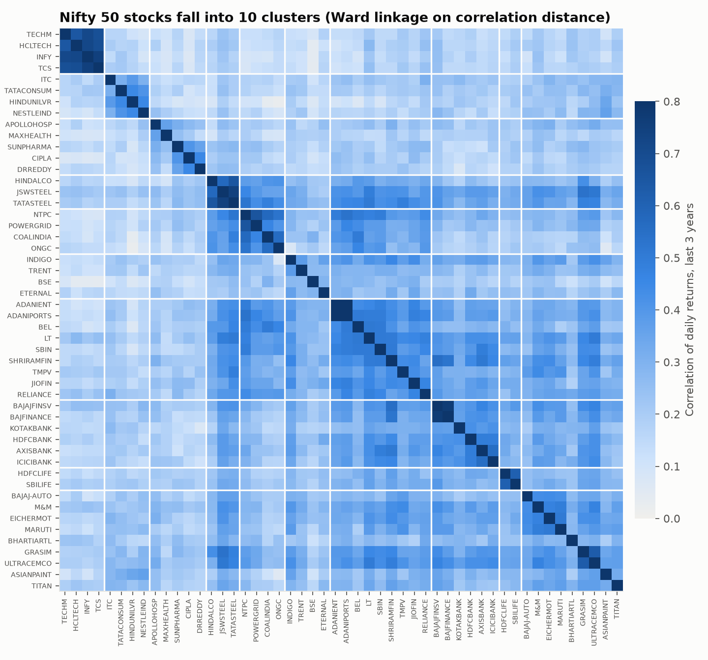

# Nifty 50 Risk, Regimes and Backtests

How risky are India's 50 largest stocks, when does diversification fail, and do simple strategies or smarter portfolio weights beat just holding the index after costs? Ten years of daily data, DuckDB SQL for the risk layer, Python for the models, every headline number out of sample.

**Dashboard:** Tableau Public *(link added once published)* · **Data:** NSE constituent list + Yahoo Finance daily prices, 1 Jan 2015 to 23 Oct 2026


## Business question

A risk or wealth team needs three answers before putting money into Indian large caps:

1. **Risk:** how volatile is each stock, how deep and how long are its drawdowns, how much does it move with the market, and is the Value at Risk model honest?
2. **Regimes:** what changes when markets get stressed, and does diversification still work then?
3. **Decisions:** after costs, does trend timing, momentum, or a risk-based portfolio (minimum variance, risk parity, HRP) beat buy-and-hold, by more than luck?

## Key results

| Finding | Number |
|---|---|
| Trend timing lost to buy-and-hold | SMA 50/200: **6.6% a year vs 12.4%** (Sharpe 0.10 vs 0.48). Re-picking the SMA pair every year (walk-forward) did no better: 6.8% |
| Diversification fades in stress | Average correlation between stocks: **0.19 in calm markets, 0.49 in stressed ones**. Stressed days are 10.7% of the sample, with 3x the daily volatility (2.18% vs 0.74%) |
| Momentum's edge was survivorship bias | Momentum 12-1 returned 25.6% a year, but an equal-weight basket of the same 50 stocks returned 21.9% with a higher Sharpe (0.93 vs 0.91). Momentum beat it in only **45% of bootstrap resamples** |
| Risk-based weights cut drawdowns, not returns | HRP: max drawdown **-32.6% vs -37.9%** for equal weight, volatility 14.5% vs 16.6%, same Sharpe range. In stressed regimes HRP lost 11.9% a year vs 16.8% |
| GARCH VaR is the only model that passes both tests at 99% | Historical and normal VaR fail Christoffersen's independence test (breaches cluster). GARCH-t at 99%: 36 breaches vs 26.6 expected, Kupiec p = 0.08, Christoffersen p = 0.51 |
| GARCH beats rolling volatility as a forecast | Lower loss on both measures for the index: QLIKE 1.52 vs 1.73, MSE 18.4 vs 21.4 |


The chart above is the honest view: Sharpe ratios on ten years of daily data come with wide ranges (95% bootstrap). Every portfolio of the 50 stocks beats the index ETF, but that gap is the survivorship bias described below, not skill.

## Data

| Item | Detail |
|---|---|
| Universe | Today's 50 Nifty 50 members (NSE `ind_nifty50list.csv`, pulled 26 Oct 2026) |
| Prices | Yahoo Finance daily OHLCV and adjusted close via `yfinance`, 1 Jan 2015 to 23 Oct 2026, 144,371 rows |
| Market | `^NSEI` (Nifty 50 price index) for beta and regimes; `NIFTYBEES` (Nifty 50 ETF, dividends kept in the price) as the buy-and-hold benchmark |
| Risk-free rate | 6.0% a year, a stated assumption for the 91-day T-bill over the period |
| Costs | 10 bps per unit of turnover, every rebalance |

Raw prices are not in this repo (Yahoo's terms). `make data` downloads them again.

### Data quality fixes

The scan flagged every daily move over 18%, then each one was checked against news and corporate actions. Real events stay (Mar 2020, the Adani short report in Jan 2023, election day Jun 2024, IndiGo's Jan 2016 results, ITC on 1 Jan 2026). Four were data errors, fixed and logged in [`data/price_fixes.csv`](data/price_fixes.csv):

| Ticker | Date | Problem | Fix |
|---|---|---|---|
| NIFTYBEES | 19-20 Dec 2019 | Two prints at one tenth of the price (old 1:10 split) | Rows dropped |
| TRENT | 1 Jan 2026 | Yahoo applied the June 2026 1:2 bonus from January, so a fake -33% day | History before 1 Jan scaled by 1/1.5 |
| ADANIENT | 3 Jun 2015 | Demerger ex-date shown as a -39% loss | Return set to 0 |
| TMPV | 14 Oct 2025 | Tata Motors demerger shown as a -40% loss | Return set to 0 |

All stocks are also aligned to the index's trading calendar, so weekend Diwali sessions and the few days Yahoo lacks for the index never create mismatched returns.

## Approach

```
NSE list + Yahoo prices ─► DuckDB (SQL) ─────────────────► Python models ─────────────► Tableau + README
  ingest.py                01_stage: raw + fixes + calendar  risk.py      CAPM, clusters, VaR, GARCH
                           02_clean: fixes, returns, wealth  regimes.py   Markov switching
                           03_metrics: drawdowns, rolling    backtest.py  SMA, momentum, regime filter
                             vol, CAGR, Sharpe, Sortino      portfolio.py EW, inv-vol, min-var, ERC, HRP
                                                             evaluate.py  bootstrap, regime split
```

- **Risk layer in SQL.** Returns, wealth, drawdowns (gaps-and-islands for time under water and recovery), 21-day rolling volatility, and per-stock CAGR, Sharpe, Sortino, Calmar, skew and kurtosis are all DuckDB window queries in [`sql/`](sql/). A test checks the SQL numbers against Python for HDFC Bank.
- **Market model.** CAPM regression of every stock on the index with Newey-West errors, plus a rolling 252-day beta.
- **Clusters.** Ward linkage on correlation distance over the last 3 years gives 10 groups. They mostly match NSE sectors but split "Financial Services" into private banks with Bajaj, insurers, and BSE with the new-age names, and put PSU energy and power together.
- **VaR backtest.** One-day 95% and 99% VaR from three models (historical 250-day, normal, GARCH(1,1) with Student-t errors refit monthly), each scored with Kupiec (right number of breaches?) and Christoffersen (do breaches cluster?) over 2,656 days.
- **Regimes.** A two-state Markov switching model on index returns. The full-sample version labels history. A walk-forward version, refit each January on earlier data only, drives the trading rule.
- **Backtests.** Signals use data up to the close and trade from the next day. SMA 50/200, an SMA walk-forward that picks the best pair each January from 11 pairs, momentum 12-1 (top 10, monthly) and a regime filter. Parameter grids are reported as ranges, not as the headline.
- **Portfolio construction.** Each month-end, weights come only from the last 252 days with a Ledoit-Wolf shrunk covariance: equal weight, inverse volatility, minimum variance (max 10% a stock), equal risk contribution and HRP.
- **Statistics.** A stationary block bootstrap (2,000 resamples, 21-day mean block, same days for each strategy and its benchmark) gives a 95% range for every Sharpe and for each Sharpe gap.

## More results

**Stocks (Jan 2015 to Oct 2026).** Median annual volatility 29%, median max drawdown -54%. Lowest betas: Nestle, Dr Reddy's, Cipla (about 0.5). Highest: Adani Enterprises (1.52), Tata Motors PV (1.44), Shriram Finance (1.41). The index explains a median 24% of a stock's daily moves (HDFC Bank 54%, Max Healthcare 6%). Nine stocks show a statistically significant CAPM alpha, all strong performers that are in the index today, which is the same survivorship effect again.

**Regimes.** The model finds stressed spells in Feb 2016, Feb to Jun 2020, Apr to May 2022 and Mar to Apr 2026, plus short bursts. In stressed days the index fell at a 29% annual rate.


**Strategies by regime (annualised).**

| Strategy | Calm | Stressed |
|---|---|---|
| Buy and hold (Nifty ETF) | 18.3% | -26.5% |
| Equal weight | 27.7% | -16.8% |
| HRP | 23.6% | -11.9% |
| Minimum variance | 18.7% | -12.4% |
| SMA 50/200 | 13.9% | -38.9% |
| Regime filter | 9.8% | -34.0% |

Timing rules do avoid the worst single days (the regime filter's worst stressed day was -3.7% vs -10.2% for buy-and-hold), but they exit after the fall and miss the rebound, which in this sample often came inside the same stressed spell. The regime filter also traded 22 times a year, costing 2.2% a year in fees.

**Robustness.** Momentum Sharpe stays between 0.63 and 0.99 across 16 lookback and size settings, always close to equal weight's 0.93. SMA Sharpe ranges from -0.02 to 0.51 across 11 pairs; only one pair (20/100) edges past buy-and-hold's 0.48, and picking pairs that way each year (walk-forward) still scored 0.12. Regime filter Sharpe ranges from -0.14 to 0.19 across stress thresholds 0.3 to 0.9.



## How to run

```bash
make setup     # virtualenv + pinned packages
make data      # download constituents and prices (about 1 minute)
make all       # DuckDB build, models, Tableau CSVs, charts, tests
```

Outputs: `data/nifty.duckdb`, `tableau/*.csv` (13 extracts for the dashboard, see [`docs/tableau_guide.md`](docs/tableau_guide.md)), `docs/images/`. Column definitions are in [`docs/data_dictionary.md`](docs/data_dictionary.md).

## Limitations

- **Survivorship bias.** The universe is today's 50 members, so the analysis never holds a stock that dropped out of the index. That is why every portfolio of these stocks beats the index ETF, by 2.5 points a year (minimum variance) up to 13 points (momentum). Comparisons between strategies on the same 50 stocks (momentum vs equal weight, HRP vs equal weight) are fair; comparisons with the index are not. A point-in-time member list would fix this.
- **Yahoo data** is unofficial. Four errors were found and fixed; smaller ones may remain. The ITC Hotels demerger (Jan 2025, about 5% of ITC's value) is left as it is.
- **Benchmark.** `^NSEI` excludes dividends, so CAPM alphas are a little high (about 1 point a year times beta). NIFTYBEES shows about 1 point less volatility than the index (closing-price method), which flatters buy-and-hold slightly.
- **Costs** are a flat 10 bps. No slippage, taxes or impact; momentum's 6.3x yearly turnover would cost more in practice.
- **Risk-free rate** is a constant 6%; real T-bill yields ranged from about 3% to 7%.
- Stocks listed after 2015 (BSE, SBI Life, HDFC Life, Max Healthcare, Eternal, Jio Financial) join portfolios only after a full year of trading.

Educational analysis. Not investment advice.

## Next steps

- Point-in-time Nifty 50 membership from NSE change notices to remove survivorship bias.
- Expected Shortfall alongside VaR, and filtered historical simulation.
- Transaction costs that scale with each stock's liquidity.
